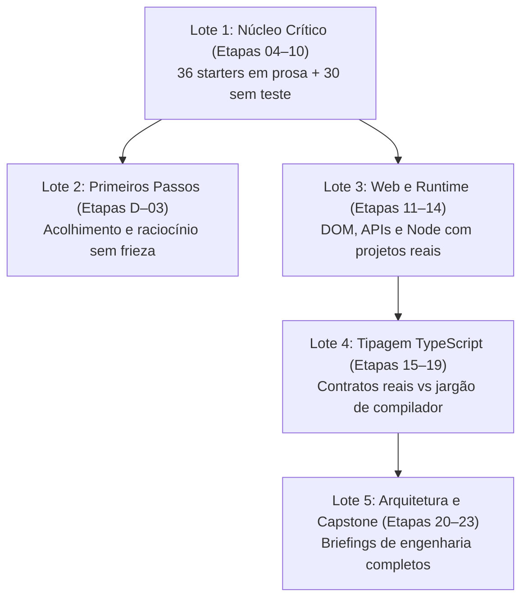

# Plano Mestre em Fases: Correção Integral do DevPath

**Data:** 13/10/2026
**Origem:** diagnóstico integral de 13/10/2026 (4 eixos: editorial, pedagógico, plataforma, senioridade) e auditoria atividade por atividade das 254 atividades (9 relatórios de lote).
**Detalhe por atividade:** [`docs/auditoria-atividades-2026-10-13/lotes/`](../auditoria-atividades-2026-10-13/lotes/). Este plano resume cada lote; o relatório tem o trecho citado e a correção proposta de cada atividade.
**Objetivo:** corrigir tudo, de ponta a ponta, em fases pequenas. Cada fase só é fechada quando a correção foi verificada.

---

## Como usar este plano

1. Execute as fases **na ordem**. Cada fase tem escopo pequeno, um passo de **verificação dos achados**, as correções e um **critério de saída**.
2. **Nenhum achado é corrigido sem antes ser confirmado.** Os relatórios de lote foram escritos por auditores automáticos, e um deles já se mostrou falso (22.09) e outro impreciso (21.08). Siga o protocolo da seção "Protocolo de verificação".
3. Marque `[x]` só quando o critério do item for comprovado por comando, teste ou leitura do arquivo publicado, não quando o texto for editado.
4. Ao fechar qualquer fase, rode a **sequência de fechamento**. Ela precisa passar antes da fase seguinte.
5. As decisões de produto já foram tomadas (seção "Decisões tomadas", D1–D6). Os itens que dependem delas citam o ID.

### Protocolo de verificação (vale para toda fase)
Para cada achado do escopo da fase:
1. **Ler** o achado no relatório do lote e abrir o dado real (`course-src/…` e o publicado em `public/course-catalog.json` / `public/course-assessments.json`).
2. **Reproduzir** o problema: rodar o starter, a solução ou o teste; para texto, localizar o trecho exato. Para itens de TypeScript, rodar `node node_modules/typescript/bin/tsc --ignoreConfig --noEmit --strict <arquivo>`.
3. **Registrar** no relatório do lote, ao lado do achado: `[✔ confirmado DD/MM]`, `[✘ falso DD/MM: motivo]` ou `[~ parcial DD/MM: o que muda]`.
4. **Corrigir** só o que foi confirmado, sempre **na fonte** (ver "Onde editar").
5. **Provar**: o teste novo falha no starter (ou na versão com o bug) e passa na solução; o texto publicado mostra a correção.

### Onde editar (fonte de verdade)
| Conteúdo | Fonte | Depois de editar |
|---|---|---|
| Etapas D–19: texto, kind, rubrica, review | `course-src/recipes/<etapa>.py`, `course-src/stages/<etapa>.txt`, `course-src/publication-overrides.json`, `course-src/prerequisite-primers.json` | `npm run build:curriculum` |
| Diagnóstico e etapas 00–03: preparação guiada | `course-src/diagnostic-preparation.mjs`, `stage00-preparation.mjs`, `stage01-preparation.mjs`, `stage03-preparation.mjs`, `build-stage00-preparation.mjs`, `guided-preparation.mjs` (vale para 04+ também) | `npm run build:curriculum` |
| Starters, testes e soluções 04–14 | `course-src/starters/<id>/`, `course-src/tests/<id>.test.js`, `course-src/solutions/<id>/`, `course-src/mutants/`; avaliações direto em `course-src/assessments.json` (não há gerador para 04–14) | `npm run build:curriculum` |
| Avaliações 15–19 | Geradas por `scripts/task-8b-stage15.mjs` e `scripts/task-8b-stages16-19.mjs`. **Não** editar as entradas 15–19 de `assessments.json` à mão | Rodar o gerador, depois `npm run build:curriculum` |
| Etapas 20–23 (tudo) | `scripts/task-9-stage20.mjs` … `task-9-stage23.mjs` e demais `scripts/task-9-*.mjs` | `node scripts/task-9-canonical-regeneration.mjs`. **Não** editar `course-src/assessments.json` direto: a regeneração sobrescreve. |
| Qualquer arquivo em `public/` | — | `npm run assets:version` |

### Sequência de fechamento de fase
```bash
npm run check:curriculum
```
```bash
npm test
```
```bash
node docs/auditoria-atividades-2026-10-13/contrato-oculto.mjs
```
Mais os gates da Fase 2.5 da análise curricular após sua entrega. **Reprogramação em 15/10/2026, por solicitação do usuário:** o fechamento pendente da Fase 2.5 foi incorporado ao bloco 6.0 da Fase 6 da análise curricular, antes de 6.1–6.4. Reaproveitar os gates já existentes; a exigência integral passa a valer após o fechamento de 6.0. Se algo em `public/` mudou, rodar `npm run assets:version`.

### Restrições
- Preservar os IDs existentes e o progresso dos alunos. Atividades novas são permitidas. Mudança de ID ou de posição exige migração testada em `public/progress-migrations.js`. Decisão já tomada: 06.10 e 12.13 ficam onde estão.
- Nada é publicado em produção sem autorização explícita.
- Código em inglês; interface, cartões e documentos em português.

---

## Resumo do estado

O estado atual está em 'Situação em uma página' na análise curricular (12/10). As métricas abaixo são as dos lotes (13/10). Não são comparáveis linha a linha com a análise:

- **Sem teste (144):** atividades sem entrada em `course-tests.json`, na auditoria de 13/10. A análise usa 'sem avaliação' (74): atividades sem entrada em `course-assessments.json`. São medidas diferentes.
- **Rubrica genérica:** 45 no mestre (13/10) e 44 na análise (12/10). Medem o mesmo problema. A diferença de uma unidade deve ser de data ou de contagem.
- **Starters `.md`:** 52 no total (mestre); 36 deles estão em 04–14 (análise).
- **Gravidade por atividade (auditoria):** 74 ALTA · 119 MÉDIA · 59 BAIXA · 2 OK (16.02 e 19.02).

---

## Mapa das fases

| Bloco | Fases | Resultado |
|---|---|---|
| A. Base | 0 | Linha de base registrada. As antigas fases 1 a 3 foram para a análise curricular (itens P.1, P.2 e 0.1 a 0.4) |
| C. Gerador | 5 | Defeitos repetidos em dezenas de atividades corrigidos de uma vez |
| D. Integridade de gabarito | 7–12 | Nenhuma atividade com gabarito, teste ou solução errados |
| E. Correção por lote | 13–23 | Cada atividade revisada, verificada, com texto de 4 blocos, código real e teste forte |
| H. Fechamento | 34 | Gates em modo erro, regressão completa, documentação atualizada |
| I. Metodologia editorial | 35–36 | Diagnóstico, template de 4 blocos, rubrica e ações de contexto por lote |
| J. Acessibilidade | 39 | Fluxo completo por teclado, em navegador real |

---

# BLOCO A: Base e plataforma

## Fase 0: Linha de base e registro de verificação
**Escopo:** nada é corrigido; só se registra o ponto de partida.
- [ ] Rodar a sequência de fechamento e anotar o resultado (contagem de testes, avisos, falhas) no topo deste plano.
- [ ] Rodar `contrato-oculto.mjs` e guardar a saída (esperado hoje: 14 atividades).
- [ ] Conferir que os 9 relatórios de lote existem e que cada atividade tem uma seção (07.10 está só na Fase 15).
- [ ] Criar no topo de cada relatório de lote a legenda `[✔] [✘] [~]` do protocolo de verificação.

**Saída:** linha de base anotada; nenhum arquivo de conteúdo alterado.

---

# BLOCO C: Gerador (correções que valem para muitas atividades)

## Fase 5: Gerador I, dicas e previsão
**Resumo e verificação** (confirmar cada um no gerador e em 2 atividades publicadas):
- **62 dicas truncadas** no meio da palavra ("…Re", "…throw T", "…fak"): origem em `course-src/guided-preparation.mjs:60` (`clean(item.prompt).slice(0, 240)`). Além de truncar, a dica só repete o prompt.
- **Previsão invertida** em 04.01–04.10 (variantes em 05.01, 05.06, 05.10): "Antes de executar, pedir dica ou abrir a solução." Origem em `course-src/recipes/03.py` e `04.py`.
- **`firstResponse.action` = `objective`** em 238 de 254.
- **Texto de starter colado no prompt** ("Starter de trabalho: … Registre sua primeira decisão…") em 13.x e 14.x; "Use o starter descrito no contrato" em 08.01–08.04 (o contrato não existe).
- [ ] Dica nunca truncada; primeira dica é uma pista real, não a cópia do enunciado.
- [ ] Texto de previsão: "Escreva sua previsão antes de executar; peça dica só depois de uma tentativa."
- [ ] Primeira resposta gerada como pergunta própria.
- [ ] Separar resumo do starter do prompt; remover a frase do contrato inexistente.
- [ ] Gates de dica e `firstResponse` passam a **erro**.

**Saída:** 0 dicas truncadas, 0 previsão invertida, 0 `firstResponse` = objective.

# BLOCO D: Integridade de gabarito (antes de qualquer reescrita de texto)

> Reescrever o enunciado de uma atividade com teste quebrado só deixa o erro mais legível. Por isso este bloco vem antes da correção por lote.

## Fase 7: Gabaritos e conteúdo errados
| Atividade | Achado a verificar | Correção se confirmado |
|---|---|---|
| 08.07 | `review.answer: 3`; a correta é 0 (o próprio feedback a descreve). ✔ já reconferido | `answer: 0` |
| 19.06 | Feedback diz que `-?` não remove `undefined`; com `tsc --strict` remove; só com `exactOptionalPropertyTypes` não. ✔ já reconferido | Conforme **D1**: gabarito segue o `--strict` (alternativa 0); reescrever pergunta, feedback e rubrica citando a flag como nuance |
| 12.04 | Exemplo e dicas dizem `A,B,P1,Q,T`; o starter imprime `A,B,P1,Q,P2,T` | Corrigir exemplo e dicas |
| 14.13 | Exemplo `A,P,T` omite o `B` síncrono | Corrigir a sequência |
| D.05 | "Localize a falha", mas o `total` está correto | Plantar o bug (`n = x`) e teste |
| 06.06 | "JSON quebrado", mas o starter já tem `try/catch` | Starter sem proteção; teste `lerSave("{invalido") → null` |
| 01.01–01.09 | `correctFeedback` idêntico nas 9 | Feedback específico (se não resolvido na Fase 2.5 da análise curricular) |
- [ ] Protocolo de verificação para cada linha; registrar no relatório do lote.

**Saída:** as 7 linhas confirmadas e corrigidas, ou marcadas como falsas.

## Fase 8: Solução e testes incompatíveis com o starter
| Atividade | Achado a verificar |
|---|---|
| 23.10 | Starter usa `gerarRelatorio`/`valorCentavos`/`RangeError`; solução e suíte usam `resumir`/`totalCentavos`/`false`. ✔ já reconferido |
| 21.08 | `recurso.js` existe em `course-src/solutions/21.08/` mas não entra em `correctFiles`. ✔ já reconferido |
| 21.07 | Harness passa `{agora, setTimeout, clearTimeout}`; solução lê `{set, clear, now}`; prompt diz 100 eventos, starter simula 4 |
| 13.14 | Testes 1 e 2 passam o save como `storage` sem `getItem` |
| 18.10 | Testes reprovam o starter (2 de 3); solução muda `handle` |
| 16.03 | `linha` (exemplo/starter) vs `codigo` (teste/solução) |
| 11.04, 11.05 | `#inscricao` e `#lista` nunca criados; `mount` não existe |
| 13.03, 13.09, 13.13 | Testes importam `pagination.js`, `retry.js` e HTML ausentes do starter |
| 14.11 | `package.json` do starter com prosa após o JSON |
- [ ] Regra: a suíte se adapta à API do starter, nunca o contrário (a menos que o prompt mande mudar a API).
- [ ] Gates "solução publicada completa" e "starter falha / solução passa" passam a **erro**.

**Saída:** as 13 atividades com starter, suíte e solução coerentes, verificados pelo gate.

## Fase 9: Soluções de referência com bug
| Atividade | Achado a verificar |
|---|---|
| 18.07 | `porId[id]` retorna `undefined` para `constructor`/`toString`/`__proto__` em vez de `RangeError` |
| 20.08 | `take` não posicional; `break` não chama `return()`; builder mutável; prompt pede generators e a solução não usa |
| 21.09 | `comparar` não exportada (`ReferenceError`); mediana com índice superior para n par (contra 21.03) |
| 16.10, 23.02 | Solução expõe `e.message`/`cause` na resposta pública, contra a rubrica |
| 22.08 | Rubrica exige declaração gerada; build copia `.d.ts` manual; consumidor dentro do pacote |
| 07.06 | Reduce com `{}` corrompe chaves `toString`/`__proto__` |
- [ ] Para cada bug confirmado: corrigir a solução **e** adicionar o teste que o pegaria.

**Saída:** cada solução corrigida tem um teste que falha na versão antiga.

## Fase 10: Contratos ocultos
**Resumo:** 14 suítes exigem nomes que o aluno nunca vê: 20.01 `percorrer`, 20.04 `observar`, 20.05 `validarUser`, 20.09 `criarStream`/`consumirLento`, 20.10 `medirTexto`/`decodificar`, 21.06 `criarCache`/`cachePorId`, 21.08 `usarRecursos`, 22.04 `migrar`, 22.05 `executar`, 23.02 `criarServico`, 23.03 `StorageError`, 23.04 `criarCadastroCliente`, 23.09 `lerLogs`/`limparLogs`, 23.10 `resumir`. Contratos de **formato** ocultos: 11.03, 11.08, 11.13, 14.06, 15.07 (**D2**: `RangeError` fixo, declarado no prompt), 16.10, 21.05.
- [ ] Rodar `contrato-oculto.mjs` e confirmar a lista.
- [ ] Declarar o nome e a assinatura no starter (stub exportado) e no bloco "Contrato" do prompt.
- [ ] Gate de contrato oculto passa a **erro**.

**Saída:** `contrato-oculto.mjs` reporta 0; contratos de formato declarados.

## Fase 11: Mutantes e testes que travam
**Resumo:** 61 atividades com teste não têm mutante; 10 (15.x/16.x) têm `mutants: "plausible"`; o mutante `lo = mid` da 08.03 trava a suíte.
- [ ] Timeout por teste no runner de avaliação.
- [ ] Formato válido de mutante em 15.02–15.04, 15.07, 15.08, 15.11, 16.02–16.05.
- [ ] Os mutantes das 61 atividades entram nas fases de lote (cada lote cria os seus). Aqui só a infraestrutura e o gate.

**Saída:** mutante que trava vira falha; nenhum `mutants` inválido.

## Fase 12: Runner de teste único por etapa
**Resumo:** o starter usa `node:test`/`assert` e o avaliador usa `describe/test/expect` globais em 04.09, 14.03, 14.08 e 22.09; a 14.03 manda `vitest run`, mas o lock não tem Vitest; a 13.01 diz "o site não executa Vitest", mas 13.02–13.13 têm `autoTested: true`.
- [ ] Aplicar **D3**: `expect` no site até a 13; `node:test` a partir da 14.03 em projetos locais, com a 14.03 contrastando os dois; 04.09 passa para `expect`.
- [ ] Declarar no cartão onde a verificação roda (site ou computador local).

**Saída:** cada atividade testada usa no starter o mesmo runner do avaliador.

---

# BLOCO E: Correção por lote

### O que toda fase de lote faz (além do resumo específico)
1. **Verificar** cada achado do relatório do lote pelo protocolo, inclusive os que já foram tratados nos Blocos C e D (só confirmar que sumiram).
2. **Corrigir as ALTA** restantes, depois MÉDIA e BAIXA.
3. **Materializar** os starters só em `material.md` do lote em código executável (Parsons com blocos reais e `check()` de ordem que aceite ordens válidas; TRACE/PREDICT com `main.js` que imprime os estados).
4. **Testar** as atividades sem teste automatizado do lote. Para READ/COMPARE, quando não couber teste, usar rubrica específica com 3 critérios verificáveis. Todo teste novo vem com ≥ 1 mutante ingênuo.
5. **Reescrever** o enunciado no **template de 4 blocos** (prioridade: prompts < 150 caracteres e ALTA):
   - *Cenário* (RPG ou produto real, 1–2 frases);
   - *Problema/Por quê* (o custo de errar);
   - *Missão* (passos numerados no imperativo, sem letras vazias nem jargão);
   - *Contrato* (entrada → saída com exemplo, gerado a partir do que a suíte importa).
   Instruções de interface ("clique", "registre previsão") saem do prompt e vão para `interaction`.
6. **Rubrica específica** com critérios verificáveis no lugar da genérica.
7. **Duração** revista quando o relatório apontar valor irreal.
8. **Fechar** com a sequência de fechamento e os gates do escopo do lote sem aviso.

## Fase 13: Lote 1 (D.01–02.07, 30 atividades)
[Relatório](../auditoria-atividades-2026-10-13/lotes/relatorio-lote-1.md) · ALTA 4 · MÉDIA 13 · BAIXA 13
- **ALTA:**
  - D.05: sem bug (Fase 7).
  - 00.03: "Início, Olá, Ana e Fim" são 4 itens para 3 linhas; o scoring diz "não exija ordem", mas o expected exige.
  - 00.09: o fixture aceita apagar a linha "Itens:" em vez de exigir `Itens: 0`.
  - 01.09: as transferências exigem "duração 30" e "2 dias | 6 horas", que o enunciado não mostra.
- **Transversal:** feedback idêntico em 01.01–01.09 (Fase 2.5 da análise curricular / Fase 7).
- **Prosa → código (13):** D.02, 00.05, 01.02–01.09, 02.01–02.03.
- **Sem teste (30 de 30):** criar verificação para todas as executáveis; o diagnóstico (D.x) pode usar checagem de saída.
- **Prompts < 150 (14):** D.01–D.05, 01.01–01.09.
- **Atenção:** tirar a frieza de prova das primeiras etapas e do diagnóstico.

## Fase 14: Lote 2 (02.08–05.10, 30 atividades)
[Relatório](../auditoria-atividades-2026-10-13/lotes/relatorio-lote-2.md) · ALTA 4 · MÉDIA 15 · BAIXA 11
- **ALTA:**
  - 03.04: um placeholder para três ramos; 14 min irreal.
  - 04.03: "funções A, B, C, D" → nomes reais (`cParaF`, `formatar`, `exibir`, `main`) e blocos de código reais.
  - 04.07: o teste não distingue `Math.ceil` de `Math.round`; adicionar `adicionarTaxa(1, 0.1) === 1` e `adicionarTaxa(333, 0.07) === 356`.
  - 04.09: starter em `node:test` e avaliador em `expect` (Fase 12).
- **Também:**
  - 03.03: Parsons rejeita ordem válida (`three`/`five` exclusivos).
  - 04.03, 04.08, 04.09: vocabulário de outro domínio.
  - 9 atividades com `mutants: []`.
  - Pré-requisitos ocultos: `node:test` (04.09), ESM (04.07), objetos (04.05, 05.04), arrays/spread (04.02), callbacks (05.03) → análise, 4.14.
- **Prosa → código:** 03.05, 04.03.
- **Sem teste (21):** 02.08–02.12, 03.01–03.09, 04.01–04.03, 04.08, 04.10, 05.01, 05.03.
- **Prompts < 150:** 03.01, 03.02, 03.06, 05.04, 05.10.
- **Atenção:** 05.07 cobra `throw TypeError` antes da etapa 13 (análise, 4.14).

## Fase 15: Lote 3 (05.11–08.05, 30 atividades)
[Relatório](../auditoria-atividades-2026-10-13/lotes/relatorio-lote-3.md) · ALTA 4 · MÉDIA 15 · BAIXA 12
- **ALTA:**
  - 06.06: sem bug (Fase 7).
  - 07.01: gabarito completo vazado no hint e nos examples (12 respostas).
  - 07.06: reduce corrompe `toString`/`__proto__` e usa `itens` não declarado.
  - 08.01: lista de nomes em `.md`, mas o prompt manda "executar"; hint com as 8 respostas; bridge de BFS que é da 08.07.
- **Também:**
  - 07.03: bloco "filtrar partidas válidas" sem entrada; "exibir ids" vs saída de nomes; `.sort()` ingênuo passa → caso `["Zeca","ana","Bia"]` e `João/Joao` com `localeCompare('pt-BR')`.
  - 08.03: mutante trava (Fase 11).
  - 07.09: inglês ao aluno.
  - 05.08: formato de data prometido e não testado.
  - 06.08: review não corresponde à resposta.
  - 05.05: `RegExp.escape` sem runtime declarado.
  - 05.11: "grafema" e `Intl.Segmenter` sem ensino.
- **07.10 (fora do relatório; auditada à parte, MÉDIA):**
  - o `objective` é instrução de previsão;
  - a review pergunta sobre `map` (1:1), não `flatMap` (0..N);
  - a comparação com `map().flat(1)` pedida no prompt não é cobrada;
  - sem mutantes;
  - rubrica genérica.
- **Prosa → código (7):** 06.02, 06.03, 07.01, 07.03, 08.01, 08.02, 08.04.
- **Sem teste (13):** 05.11, 06.01–06.03, 06.05, 06.06, 06.10, 07.01, 07.03, 07.06, 08.01, 08.02, 08.04.
- **Prompts < 150:** 05.11, 06.01–06.03, 07.03–07.05, 07.10.
- **Atenção:** 06.02 "aliasing visual" → "dois jogadores apontando para o mesmo inventário".

## Fase 16: Lote 4 (08.06–11.12, 30 atividades)
[Relatório](../auditoria-atividades-2026-10-13/lotes/relatorio-lote-4.md) · ALTA 6 · MÉDIA 17 · BAIXA 7
- **ALTA:**
  - 08.07: gabarito (Fase 7).
  - 10.06: MODIFY sem código; exemplo de instrumentos; "hierarquia artificial".
  - 11.03: `result.valores` exigido no erro e não declarado.
  - 11.04: `#inscricao` inexistente (Fase 8).
  - 11.05: `mount` inexistente; estado compartilhado entre testes (Fase 8).
  - **11.12 (segurança):** o teste passa com `innerHTML` vulnerável; nomes `renderComentario`/`mostrarTitulo`/`mostrarComentario` divergentes. Usar DOM real e `expect(alvo.querySelector('img')).toBeNull()`.
- **Também:**
  - 08.06: ordenação passa no lugar de preservar a ordem.
  - 09.04: `inc` retorna `undefined`.
  - 10.02: `saldo` sem `.`.
  - 10.07 e 11.06: contrato oculto.
  - Durações irreais: 6 min em 11.09 e 11.14; 9 min em 11.01; 10 min em 10.02 e 11.03.
  - Bridge da 11.09 concentra `AbortController`/`FormData` sem ensino.
- **Prosa → código (14):** 09.01, 09.02, 09.04, 09.05, 09.07, 10.01, 10.02, 10.06, 10.07, 11.01, 11.02, 11.09, 11.11, 11.14.
- **Sem teste (15):** 08.07, 09.01, 09.02, 09.04, 09.05, 09.07, 10.01, 10.02, 10.06, 10.07, 11.01, 11.02, 11.09, 11.11, 11.14.
- **Prompts < 150:** 11.02–11.04, 11.06, 11.09, 11.11, 11.12, 11.14.

## Fase 17: Lote 5A (Kanban 11.08, 11.10, 11.13 e etapa 12)
[Relatório](../auditoria-atividades-2026-10-13/lotes/relatorio-lote-5.md) (seções 11.x e 12.x)
- **ALTA:**
  - 11.08: contrato oculto `montarKanban(document, storage).getState()`; `index.html` não carrega `app.js`; texto de "reservas de equipamento".
  - 11.13: campo `done` inexistente; texto de "favoritos"; teste 4 vácuo; regras de registro parcial contraditórias.
  - 12.03: prompt pede objeto por nome, mas teste exige array; não testa conclusão fora de ordem.
  - 12.04: saída errada (Fase 7).
  - 12.05.
  - 12.06: engolir qualquer erro passa.
  - 12.08: checa `Content-Type` num fake sem headers; o teste 4 só checa status.
- **MÉDIA de destaque:**
  - 11.10: texto de "app de lembretes"; `innerHTML` no starter sem TODO; `boot` sem teste; 22 min irreal.
  - 12.10: bridge de 2.400 caracteres com 8 tópicos; "faixa" → "intervalo (Range)"; "traceie" → "rastreie".
- **Prosa → código:** 12.02, 12.07, 12.09, 12.10, 12.14.
- **Sem teste:** 12.01, 12.02, 12.04, 12.07, 12.09–12.11, 12.13, 12.14.
- **Prompts < 150:** 11.08, 11.10, 12.01–12.05, 12.07, 12.09–12.11, 12.13, 12.14.
- **Atenção:** 12.02 cobra `try/catch` antes da etapa 13 (análise, 4.14); retry com `esperar()` mockável.

## Fase 18: Lote 5B (etapa 13, 13.01–13.13)
[Relatório](../auditoria-atividades-2026-10-13/lotes/relatorio-lote-5.md) (seções 13.x)
- **ALTA:** 13.03, 13.09 e 13.13 com arquivos ausentes (Fase 8); 13.05, 13.07, 13.08, 13.10, 13.12.
- **Transversal:**
  - dica truncada em todas as 13.x (Fase 5);
  - "Volte à regra pertinente…" genérico em todo `common_trap`;
  - stageBridge da 13.01 contradiz `autoTested` (Fase 12).
- **Prosa → código:** 13.01, 13.02, 13.12.
- **Sem teste:** 13.01, 13.02, 13.04, 13.11, 13.12.

## Fase 19: Lote 6 (13.14–16.05, 30 atividades)
[Relatório](../auditoria-atividades-2026-10-13/lotes/relatorio-lote-6.md) · ALTA 10 · MÉDIA 15 · BAIXA 4 · OK 1 (16.02)
- **ALTA:**
  - 13.14: testes quebram implementação correta (Fase 8).
  - 14.03: `vitest run` vs `node:test`; só `test.todo`.
  - 14.06: `NODE_ENV`/`TOKEN` e mensagem de erro ocultos; teste do segredo vácuo.
  - 14.08: repositório JSON e JSON inválido sem teste.
  - 14.11: JSON inválido (Fase 8).
  - 14.12: bundle prometido não existe.
  - 14.13: exemplo errado (Fase 7).
  - 15.07: lista vazia lança `RangeError`, declarado no prompt (**D2**); valor padrão vai para a transferência.
  - 15.08: `paginacao.ts` importado e não fornecido.
  - 16.03: `linha`/`codigo` (Fase 8).
- **Também:**
  - `visible_rubric` diverge de `assessment.rubric` em 14.01, 14.04, 14.06, 14.11 e 14.12 (Fase 2.5 da análise curricular);
  - `mutants` inválidos (Fase 11);
  - pré-requisitos `import.meta.url`, `import()` dinâmico, `{cause}`, `Object.hasOwn` e `Error.isError` (análise, 4.14).
- **Prosa → código:** 14.01, 14.02, 14.04, 14.09, 14.10, 14.12 (14.12 precisa de build real ou fixture de saída).
- **Sem teste (17):** 14.01–14.05, 14.07, 14.09–14.13, 15.01, 15.06, 15.09, 15.10, 16.01, 16.09.
- **Atenção:** a 14.03 deve contrastar `node:test` com Vitest.

## Fase 20: Lote 7 (16.10–19.07, 30 atividades)
[Relatório](../auditoria-atividades-2026-10-13/lotes/relatorio-lote-7.md) · ALTA 6 · MÉDIA 16 · BAIXA 7 · OK 1 (19.02)
- **ALTA:**
  - 16.06: domínio copiado de outra atividade; sem solução.
  - 16.10: starter retorna em vez de relançar; mensagem oculta; solução vaza `e.message` (Fase 9).
  - 18.05: `handle` deixa de compilar após a Tarefa 2 sem instrução; "comandos" vs "eventos".
  - 18.07: `__proto__` (Fase 9).
  - 18.10: Fase 8.
  - 19.06: Fase 7.
- **Também:**
  - 8 atividades com `autoTested: true` sem teste nem solução: 16.06, 17.05, 17.07, 18.04, 18.05, 19.03, 19.04, 19.05.
  - 19.05: `declare` impede a execução.
  - Distratores absurdos em 16.07, 17.09 e 18.05.
  - "alias" com gênero inconsistente.
  - Pré-requisitos `#campo` (17.02), `noUncheckedIndexedAccess` (18.03), `exactOptionalPropertyTypes` (18.02) → análise, 4.14.
- **Sem teste (20):** 16.06, 17.01, 17.02, 17.05–17.07, 17.09, 18.01, 18.02, 18.04–18.06, 18.09, 19.01–19.07.
- **Atenção:** os itens de tipo exigem `tsc` (os auditores não rodaram); validar todos com o verificador. Mudar o foco de "agradar o compilador" para "proteger contratos de dados reais".

## Fase 21: Lote 8A (19.08–20.10)
[Relatório](../auditoria-atividades-2026-10-13/lotes/relatorio-lote-8.md) (seções 19.x e 20.x) · editar `scripts/task-9-stage20.mjs` e regenerar
- **ALTA:** 20.01, 20.04, 20.05, 20.06, 20.07, 20.09 e 20.10 (contratos ocultos, Fase 10); 20.08 (pipeline com 3 bugs, Fase 9).
- **Prompts < 150:** 20.03, 20.04. Expandir com dados de entrada, limites e arquivo de entrega.

## Fase 22: Lote 8B (21.01–22.07)
[Relatório](../auditoria-atividades-2026-10-13/lotes/relatorio-lote-8.md) (seções 21.x e 22.x) · editar `scripts/task-9-stage21.mjs` e `task-9-stage22.mjs` e regenerar
- **ALTA:**
  - 21.02: `montar`/`desmontar` com assinatura oculta.
  - 21.05: Worker nunca instanciado no teste; `RangeError` oculto. Teste de integração com Worker mock: id certo, concorrência, `encerrar()` rejeita pendentes, fallback.
  - 21.06–21.09: Fases 8, 9 e 10.
  - 22.04, 22.05: `process.argv` quebra no Windows; contratos diferentes.
  - 22.07: transfer em prosa; sem suíte de referência nem mutantes.
- **21.04:** starter, teste e solução já são só LRU e estão coerentes; corrigir apenas "limite/expiração" no prompt.
- **Prosa → código:** 21.01.
- **Sem teste:** 21.01, 21.08, 21.10, 21.11, 22.01, 22.02.
- **Prompts < 150 (17):** quase todo o lote. Template de 4 blocos com warmup, mediana de M execuções, 100 eventos, arquivo de entrega (`memo.js`, `worker.js`/`main.js`, `lib.js`/`lib.d.ts`…). 22.01: cenário "`lib-npc` do npm cujo `.d.ts` mente".
- **D4:** na 21.05, acrescentar entradas aleatórias com semente fixa comparadas com a referência, para que uma tabela de consulta não passe.

## Fase 23: Lote 9 (22.08–23.11 e capstones)
[Relatório](../auditoria-atividades-2026-10-13/lotes/relatorio-lote-9.md) · ALTA 8 · MÉDIA 6 · editar `scripts/task-9-stage22.mjs` e `task-9-stage23.mjs` e regenerar
- **ALTA:**
  - 22.08: `.d.ts` manual; consumidor dentro do pacote; `entryPath` `.js` vs `.ts`.
  - 23.01: "nenhuma edição exigida" vs rubrica que exige fake repository testado.
  - 23.02: expõe a causa (Fase 9); `criarServico` (Fase 10).
  - 23.03: testes exigem implementação; o prompt pede só o contrato.
  - 23.04: `criarCadastroCliente` oculto; o passo 2 quebra `legado.test.js`; troca de `==`/`isNaN` sem teste. Passos numerados com "rode os testes após cada passo".
  - 23.08: capstone de 30–50 h descrito em 129 caracteres. PRD mínimo: comandos `npm pack`/`tsc --strict`/testes, estrutura `src/dominio.ts`, `portas.ts`, `adapters/memoria.ts`, persistência substituível, README de decisões, diagrama UI → service → domain/repository como artefato.
  - 23.09: `lerLogs`/`limparLogs` ocultos.
  - 23.10: Fase 8.
- **MÉDIA:**
  - 22.09: `tsconfig` sem `exclude` de testes; nome do pacote diverge; consumidor importa o fonte.
  - 22.10: `composite` e seta invertida; 22 min → 40 min.
  - 23.05–23.07, 23.11.
- **Transversal:**
  - `transfer.rubric` = `assessment.rubric` em todas;
  - `firstResponse` = objective (Fase 5);
  - ordem 23.10/23.11 antes de 23.08 vs narrativa do `stageBridge` → confirmar a ordem real.
- **Sem teste:** 22.08–22.10, 23.01, 23.05–23.08.

---

# BLOCO H: Fechamento

## Fase 34: Fechamento e regressão completa
- [ ] Todos os gates da Fase 2.5 da análise curricular em modo **erro** e passando.
- [ ] Fase 39 concluída e registrada. Rodar `scripts/check-local-course.mjs` (análise, item 3.10).
- [ ] `contrato-oculto.mjs` reporta 0.
- [ ] Nenhum relatório de lote com achado sem marca `[✔]`, `[✘]` ou `[~]`.
- [ ] Recontagem: prompts < 150, starters `.md`, atividades sem teste, rubricas genéricas, títulos sem acento e dicas truncadas, comparada com a linha de base da Fase 0.
- [ ] Teste no navegador (Chromium) das etapas com DOM e Worker.
- [ ] Atualizar `docs/analise-curricular-2026-10-05.md` e o registro de execução com o estado final.

**Saída:** auditoria refeita sem nenhuma atividade ALTA.

---

# BLOCO I: Metodologia editorial

> Conteúdo incorporado de `plano-revisao-editorial-e-contexto.md` (13/10/2026). O documento foi excluído depois da incorporação. As fases 35 e 36 são a referência de escrita dos enunciados; a execução por atividade continua nas fases 13 a 23.

## Fase 35: Diagnóstico, template e critérios editoriais
**Resumo:** os enunciados do DevPath são técnicos e telegráficos. Dois padrões prejudicam o aprendizado.

**Diagnóstico:**
1. **Enunciados telegráficos ou enigmáticos.** 82 atividades têm enunciado com menos de 150 caracteres, como `21.04` ("Depurar memoization que cresce para sempre; introduzir política de limite/expiração.") e `23.08` ("Construir aplicação ou biblioteca de porte médio..."). O aluno não sabe que dado está manipulando, por que isso importa, nem onde se encaixa num sistema real.
2. **Jargão acadêmico e abstrações arbitrárias.** Letras artificiais, como em `04.03` ("A, B, C e chamada D"), e metáforas sem explicação, como em `06.02` ("aliasing visual") e `10.06` ("hierarquia artificial Personagem->MagoCuradorVoador").
3. **Falta da tríade contexto → problema → critério.** O aluno é cobrado por regras de validação e casos de borda antes de entender o problema. Não há separação visual entre cenário, missão e avaliação.

**Template obrigatório:** todo enunciado revisado ou criado segue quatro blocos, no campo `prompt` e em `preparation`:
1. **Cenário do mundo real.** Uma ou duas frases que situam o aluno numa funcionalidade real, como um inventário no RPG, um checkout de e-commerce ou uma fila de processamento de logs.
2. **O problema (o "por quê").** O que está quebrado, ineficiente ou inseguro na abordagem ingênua. Por que a técnica foi inventada e o que acontece em produção sem ela.
3. **Sua missão.** Lista numerada de ações práticas: o que investigar primeiro, o que alterar ou implementar, o que garantir que continue funcionando.
4. **Contrato de entrada e saída.** Exemplo visual de entrada → saída esperada, sem esconder tipos ou regras.

**Exemplo, 21.04:**
> **Antes:** "Depurar memoization que cresce para sempre; introduzir política de limite/expiração."
>
> **Depois:**
> **Cenário:** No sistema de batalha do RPG, o cálculo de dano mágico consulta uma tabela de atributos pesada. Para não recalcular a mesma fórmula centenas de vezes por segundo, a equipe usou uma função `memoize()`.
>
> **O Problema:** A função atual guarda em memória todo valor já calculado e nunca descarta nada. Em partidas longas, o cache cresce indefinidamente até esgotar a memória do navegador (Memory Leak).
>
> **Sua Missão:**
> 1. Abra `memo.js` e analise como os resultados são armazenados.
> 2. Implemente a política **LRU (Least Recently Used)** com capacidade máxima configurável (padrão: 2 itens).
> 3. Quando o cache atingir a capacidade máxima e um novo item chegar, descarte o item que foi consultado há mais tempo.
> 4. Se um item já existente no cache for consultado novamente, ele deve voltar a ser considerado o "mais recente".
>
> **Contrato:** `memoizeLRU(fn, capacidade = 2)` -> função cacheada que preserva o resultado de `fn(x)`.

**Critérios de conclusão de cada atividade revisada:**
- **Rubrica de legibilidade**
  - [ ] Tem contextualização clara: por que isso importa no mundo real.
  - [ ] A missão é acionável e dividida em passos lógicos.
  - [ ] Não usa letras abstratas (A, B, C) onde cabem termos do domínio.
  - [ ] Não mistura instruções de interface ("clique aqui") com o problema de programação.
- **Consistência com os testes**
  - [ ] Nenhum enunciado pede algo que o teste não valida. Exemplo: TTL em 21.04.
  - [ ] Todos os exemplos do enunciado batem 100% com os `examples` e `edgeCases` do cartão.
- **Validação estrutural**
  - [ ] `npm run check:curriculum` passa com zero erros e zero avisos.
  - [ ] Nenhum rascunho de aluno existente é perdido. Os `id`s das atividades são preservados.

**Onde editar:** usar a tabela 'Onde editar' no topo deste plano, que é a única fonte de caminhos.

> **Dica:** para editar enunciados de 04 a 23 sem rodar o pipeline Python legado, use `course-src/publication-overrides.json`. O `build-public-curriculum.mjs` faz merge de qualquer chave (`prompt`, `firstResponse`, `preparation`) sobre o registro da atividade.

**Saída:** todo enunciado revisado usa o template e cumpre os critérios acima.



---

## Fase 36: Ações editoriais por lote
**Resumo:** a revisão dos 254 enunciados era organizada em cinco lotes editoriais. Os lotes do mestre (fases 13 a 23) são por atividade. Esta fase guarda as ações específicas de cada lote editorial e diz em qual fase do mestre cada uma é executada.

| Lote editorial | Etapas | Fases do mestre onde executar |
|---|---|---|
| 1. Núcleo crítico | 04–10 | Fases 14, 15 e 16 |
| 2. Acolhimento | D–03 | Fases 13 e 14 |
| 3. Web e runtime | 11–14 | Fases 16, 17, 18 e 19 |
| 4. TypeScript | 15–19 | Fases 19 e 20 |
| 5. Arquitetura e capstone | 20–23 | Fases 21, 22 e 23 |

**Sinergia do lote 1:** executar junto com a análise curricular, Fase 2, itens 2.0 e 2.1. É o momento em que os `material.md` viram código real.

### Lote 1: núcleo crítico (04 a 10)
**Foco:** é onde o aluno forma o modelo mental de programação, e onde a evasão é maior se o enunciado for hermético.
- [ ] **04 (funções):** contexto de pedidos e itens para `04.03` (o defeito e os nomes reais estão na Fase 14). Contextualizar parâmetros default e rest em `04.10`.
- [ ] **05 (strings e coleções):** tirar a frieza das manipulações de string. Usar cenários de sanitização de formulários e parsing de mensagens.
- [ ] **06 (objetos e referências):** contexto de perfil de jogador ou de configuração do sistema para `06.02` (o defeito está na Fase 15).
- [ ] **07 (arrays e HOFs):** trocar `filter`, `map` e `reduce` sobre listas numéricas abstratas por filtragem de inventários e agregação de relatórios.
- [ ] **10 (orientação a objetos e composição):** modelo de domínio com entidades de jogo e habilidades acopláveis para `10.06` e `10.07` (os defeitos estão na Fase 16).

### Lote 2: acolhimento (D a 03)
**Foco:** eliminar a linguagem telegráfica e o tom de "prova fria" nos primeiros minutos do aluno na plataforma.
- [ ] **Diagnóstico D:** transformar os cinco testes telegráficos em desafios com pequenas histórias que expliquem por que cada pergunta existe.
- [ ] **Etapas 00 e 01:** contextualizar o modelo de caixas e rótulos com valores visuais e analogias do cotidiano.
- [ ] **Etapas 02 e 03:** garantir que exercícios de operadores, controle de fluxo e `switch` usem decisões reais, como cálculo de bônus, status de personagem e regras de validação.

### Lote 3: web, assincronismo e ferramentas (11 a 14)
**Foco:** conectar o código ao desenvolvimento de software profissional.
- [ ] **11 (DOM):** dar contexto de interface realista às tarefas de manipulação de elementos, eventos e ao Kanban.
- [ ] **12 (async e promises):** explicar latência de rede, falha de servidor e a necessidade de `try/catch` e timeouts.
- [ ] **13 (testes e debugging):** apresentar bugs reais de produção que motivem o uso do Vitest e de dublês de teste.
- [ ] **14 (Node e bundlers):** reescrever `14.12` e `14.01`, tirando o tom de redação comparativa e transformando-os num laboratório de investigação de build.

### Lote 4: TypeScript e modelagem segura (15 a 19)
**Foco:** tratar o TypeScript como ferramenta de proteção de contrato, e não como quebra-cabeça para satisfazer o compilador.
- [ ] Explicar o impacto de cada erro de tipo, por exemplo: "o que aconteceria em produção se esse campo fosse `undefined` aqui?".
- [ ] Desmistificar genéricos nas etapas 17 e 18 com analogias de contêineres e envelopes de dados.
- [ ] Transformar os tipos utilitários e condicionais da etapa 19 em soluções para DTOs e respostas de API.

### Lote 5: arquitetura, otimização e capstone (20 a 23)
**Foco:** briefings profissionais de nível pleno e sênior.
- [ ] **21.04 (cache e memo):** o enunciado não pede TTL (decisão C3, análise item 2.8; Fase 22 do mestre). Usar o cenário de vazamento de memória do exemplo da Fase 35, com LRU.
- [ ] **21.05 (Web Workers):** explicar o congelamento da interface em operações pesadas antes de pedir o worker. Os testes ficam na Fase 22.
- [ ] **23.08 (capstone):** contexto de produto para o briefing. O PRD e a especificação ficam na Fase 23.

**Saída:** cada lote editorial cumprido na fase do mestre indicada, com os critérios da Fase 35 atendidos.

---

# BLOCO J: Acessibilidade

> Bloco reduzido em 14/10. Os itens das antigas fases 37, 38 e 40 foram para a análise curricular (itens 0.3, 3.10 e M.5). Só a Fase 39 continua aqui, porque a análise não tem verificação de teclado.

## Fase 39: Acessibilidade dos caminhos de aprendizagem
**Resumo:** "Aprender este conceito" e "Tentar de memória" têm atributos ARIA (o teste confere `aria-pressed`), mas não há verificação de teclado nem de anúncio de resultado em navegador real. O plano de 09–10/10 exige Tab, Enter, foco e anúncio do resultado.
**Verificar:** navegar pelas etapas 00 a 03 só com teclado no Chromium.
- [ ] Alternar modo, responder, pedir ajuda e executar sem armadilha de foco.
- [ ] O resultado e o estado (atual e histórico) são anunciados por uma região `aria-live` testada.
- [ ] Nenhum controle depende só de cor ou de mouse.
- [ ] O fluxo de teclado entra no gate da fase 34 como teste automatizado.

**Saída:** fluxo completo por teclado registrado em navegador real.

---

## Decisões tomadas (13/10/2026)
| ID | Decisão | O que foi decidido | Onde se aplica |
|---|---|---|---|
| D1 | 19.06: o curso usa `exactOptionalPropertyTypes`? | **Não** (só 1 de 14 atividades com `tsconfig` a usa). Gabarito segue o `--strict` (`-?` remove `undefined`); a flag aparece como nuance ("com `exactOptionalPropertyTypes`, o `undefined` permanece") | Fase 7 |
| D2 | 15.07: lista vazia tem política fixa ou livre? | **Fixa:** `RangeError`, declarada no enunciado. A política alternativa (valor padrão) vai para a transferência | Fases 10 e 19 |
| D3 | Runner de teste por faixa | **`expect` (estilo Vitest)** em tudo que roda no site até a etapa 13; **`node:test`** a partir da 14.03 em projetos locais, com a 14.03 contrastando os dois; a 04.09 passa para `expect` | Fases 12, 14 e 19 |
| D4 | 21.05: entradas determinísticas permitem tabela de consulta | **Acrescentar entradas aleatórias com semente fixa**, comparadas com a função de referência. Complementada pelos testes do Worker (análise, item 2.9). A semente fixa ainda permite especializar a resposta, e o cartão declara esse limite (decisão C4, 14/10). | Análise 2.9 |
| D5 | Medir tempo real de uso | **Decidido em 14/10 (C1):** estimar o tempo por tentativa a partir dos horários dos eventos de progresso que já existem, sem rastreamento novo. A instrumentação com consentimento (análise, item 2.7) só entra se essa estimativa não bastar. | Análise 2.7 |
| D6 | `public/course-assessments.json` expõe testes e soluções (correção no cliente) | **Revogada em 14/10 (C2):** prevalece a análise, item 0.3. A correção continua no navegador, e testes e soluções são públicos por design. Rótulos honestos: 'verificado' significa 'passou nos testes publicados'. | Análise 0.3 |

## Rastreabilidade (problema → fase)
| Código | Problema | Fase |
|---|---|---|
| T-04 | Travas 254/300 | análise, P.1 e P.2 |
| T-01 | "Demonstrado" sem rodar código | análise, 0.2 |
| T-02, T-03 | Aviso falso do executor; laço infinito | análise, 0.1 e 0.4 |
| G-03, G-04 (infra) | Gates de contrato, solução, mutante e texto | análise, Fase 2.5 |
| G-06 | Defeitos do gerador | 5; análise, Fase 2.5 |
| P-03 | Rubricas genéricas | análise, 2.2 e Fase 2.5; lotes |
| G-01 | Gabarito errado | 7 |
| G-02, P-05 | Solução/teste incompatível; LRU/TTL; Worker | 8; 22; análise, 2.8 e 2.9 |
| G-05 | Soluções com bug | 9 |
| G-03 | Contrato oculto | 10 |
| G-04 | Testes fracos e sem mutante | 11 e lotes |
| — | Runner divergente | 12 |
| E-01 a E-04 | Prompts telegráficos, jargão, template de 4 blocos, escrita | 35–36 e 13–23 |
| P-01 | Starters só em prosa | 13–23; análise, 2.0 |
| P-02 | Atividades sem teste | 13–23; análise, 2.1 |
| P-04, P-06 | Pré-requisitos ocultos | análise, 1.A a 1.C e 4.14 |
| T-05 | Carga horária | análise, 2.7 |
| S-04 | CI/CD e ferramentas | análise, 3.3 a 3.5 e 3.8 |
| S-01 | Back-end e SQL | análise, 7.1 |
| S-02 | Segurança web | análise, 7.2 |
| S-03 | E2E e contrato | análise, 7.4 |
| — | Front-end de produção; observabilidade | análise, 7.3 |
| S-05 | Engenharia com IA | análise, 7.7 |
| — | Capstone expandido | análise, 5.10 e 8.9 |
| — | Acessibilidade dos caminhos | 39 |

---

## Anexo: ordem de execução e confiabilidade da auditoria (do adendo de 13/10)

> Trecho recuperado da cópia em `RPG/planos/` antes da exclusão. As referências a "Frente" seguem a numeração da versão anterior do plano; o mapa atual está em *Mapa das fases*.

### 4. Ordem de execução recomendada (encaixe nas Frentes do plano mestre)

0. **Nova "Frente 0.5: Integridade de gabarito"** (antes das Frentes 2 e 3, cerca de 25 atividades): seções 2.1, 2.2 e 2.5. São bugs, não estilo.
1. **Gates de build** (junto da Frente 1), para que os erros não voltem:
   - todo import da suíte existe no starter ou é citado no prompt (2.3);
   - todos os arquivos de `course-src/solutions/<id>/` usados pelos testes entram em `correctFiles` (caso 21.08);
   - a solução passa e o starter falha, executados de verdade sobre os arquivos **publicados**;
   - cada atividade testada tem ≥ 1 mutante, e todo mutante falha com timeout por teste (08.03);
   - `hints` não termina no meio de palavra; títulos sem palavras conhecidas sem acento (`Transferencia`…);
   - `review.answer` dentro do intervalo, e `correctFeedback` diferente entre atividades da mesma etapa.
2. **Correções no gerador** (2.6), porque um ajuste resolve dezenas de atividades: hints, previsão invertida, `firstResponse`, links de docs, feedback e transfer.
3. **Testes mais fortes** (2.4) e **contratos explícitos** (2.3), só depois a **reescrita editorial** de 4 blocos dos planos. O bloco "Contrato visível" passa a ser gerado a partir dos nomes que a suíte importa.
4. **Frente 4 ampliada** com a tabela 2.8 e **runner único por etapa**.

Lembrete operacional: as etapas 20–23 vêm de `scripts/task-9-*.mjs`. Editar o gerador, rodar `node scripts/task-9-canonical-regeneration.mjs` e depois `npm run assets:version`. Não editar `course-src/assessments.json` direto.

---

### 5. Confiabilidade desta auditoria
- Achados marcados ✔ foram reconferidos por script ou execução (`tsc` para 19.06; inspeção dos arquivos para 23.10, 21.08 e 08.07; varreduras para as contagens).
- Os demais vêm dos auditores Haiku, que executaram trechos em Node em vários casos (12.04, 07.06, 07.03, 11.12, 18.07, 18.10, 16.10). **Confirmar antes de corrigir.** Uma afirmação deles já se mostrou falsa: 22.09 "solução não exporta `criarSlug`", quando o import `./src/index.js` resolve para `index.ts`. Outra estava imprecisa: em 21.08 a solução existe no código-fonte, e o que falha é a publicação.
- Itens que dependem de `tsc` (lote 7: 18.05, 16.06) não foram verificados pelos auditores.
- Script do contrato oculto: `docs/auditoria-atividades-2026-10-13/contrato-oculto.mjs`.
